# 🏢 Employee Management System — Acme Small Business Staff Portal

A full-stack, **industry-ready** Java web application for managing employees,
departments, attendance, and reporting for a small business. Built with
**Spring Boot**, **MySQL**, **Thymeleaf**, and **Spring Security**, featuring
a **single Super Admin** model with **dynamic, action-based privilege
granting** — no fixed roles.

---

## Table of Contents

1. [What This Project Is](#1-what-this-project-is)
2. [Key Architecture Decisions](#2-key-architecture-decisions)
3. [Feature Overview](#3-feature-overview)
4. [Technology Stack](#4-technology-stack)
5. [Database Design](#5-database-design)
6. [Project Structure](#6-project-structure)
7. [Security Model In Depth](#7-security-model-in-depth)
8. [How To Run It](#8-how-to-run-it)
9. [Demo Walkthrough](#9-demo-walkthrough)
10. [Screenshots](#10-screenshots)
11. [Future Improvements](#11-future-improvements)

---

## 1. What This Project Is

Acme is a small business that needs a secure internal portal where:

- There is **exactly one Super Admin** account, seeded automatically the
  first time the app ever starts — never created via a signup form.
- The Super Admin grants **individual permissions** (e.g. "can add
  employees", "can view reports") to staff accounts, rather than assigning
  them a fixed role like "Manager".
- Every business action (viewing/adding/editing/deleting employees,
  managing departments, viewing reports, managing attendance) is protected
  by its own permission check, enforced with Spring Security's
  `@PreAuthorize`.
- Unauthenticated visitors only ever see a public marketing landing page —
  never any employee data — until they log in.
- After logging in, users land on different pages depending on what
  they're actually allowed to do: the Super Admin goes to the Admin
  Dashboard, staff with granted permissions go to the Staff Dashboard, and
  plain employees with no permissions land on a read-only self-service
  Profile page.

## 2. Key Architecture Decisions

| Decision | Why |
|---|---|
| **Single Super Admin, seeded at startup** | No signup form can ever create an admin account. `DataInitializer` (a `CommandLineRunner`) seeds exactly one Super Admin the first time the app runs against a fresh database, and is idempotent on every restart. |
| **Action-based permissions, not roles** | Instead of `ROLE_MANAGER`/`ROLE_ADMIN`, individual `Permission` rows (e.g. `CAN_ADD_EMPLOYEE`) are granted per-user via a `UserPermission` join entity. Adding a new grantable action never requires touching Spring Security configuration. |
| **`AppUser` separate from `Employee`** | A login account (`AppUser`) is a different concept from an HR record (`Employee`). The Super Admin, for example, has no HR record at all. An `AppUser` optionally links to one `Employee`. |
| **Audit trail on every grant** | `UserPermission` records *who* granted a permission and *when* — not just a bare many-to-many relationship. |
| **Immediate effect on grant/revoke** | A custom `SessionRegistry`-based mechanism forces a user's active session to expire the instant their permissions change, so they must re-authenticate and pick up the new permission set immediately — not "next time they happen to log in". |
| **Defense in depth** | Every sensitive action is checked in at least two places: URL-level rules in `SecurityConfig`, method-level `@PreAuthorize` on the Controller, and (for UX only, never as the real security boundary) `sec:authorize` hiding buttons in the UI. |

## 3. Feature Overview

| Feature | Description |
|---|---|
| **Public Landing Page** | Hero section with a professional office photo, no data, "Login" call to action |
| **Dedicated Login Page** | Never a direct dashboard — always `/login` first |
| **Single Super Admin** | Exactly one account, seeded once, cannot be created via any UI |
| **Dynamic Privilege Granting** | Super Admin grants/revokes individual `CAN_*` permissions per user via a modal UI |
| **Immediate Permission Effect** | Grant/revoke instantly expires the affected user's session |
| **Privilege-Based Login Redirects** | Super Admin → `/admin/dashboard`, staff with permissions → `/dashboard`, plain employees → `/profile` |
| **Employee & Department CRUD** | Each action (view/add/edit/delete) gated by its own permission |
| **Reports** | Headcount & department breakdown, gated by `CAN_VIEW_REPORTS` alone |
| **Attendance Register** | Daily attendance per employee, gated by `CAN_MANAGE_ATTENDANCE` |
| **Search, Sort, Pagination** | On the employee list |
| **Server-side Validation** | Bean Validation with inline error messages |
| **CSV Export** | Employee list exportable for payroll/reporting |
| **Clean Confirmation Modals** | Bootstrap modals for grant/revoke/delete — no raw browser `confirm()` |
| **Friendly Error & Access-Denied Pages** | No stack traces or generic 403s ever shown to users |
| **Unit Tests** | JUnit 5 + Mockito, including tests that verify the single-super-admin rule is enforced in code, not just at seed time |

## 4. Technology Stack

Java 17+ · Spring Boot 3.1 (MVC, Data JPA, Security, Validation) · Hibernate ·
MySQL 8 · Thymeleaf · Bootstrap 5 · Chart.js · Maven · JUnit 5 · Mockito

## 5. Database Design

```
department 1───* employee 1───* attendance
                    │
                    │ (optional link)
                    │
app_user ───* user_permission *─── permission
   │
   └── super_admin flag (true for exactly one row)
```

- `app_user` — login accounts. `super_admin` is `true` for exactly one row.
- `permission` — the fixed catalog of grantable actions (seeded from
  `PermissionCode.ALL_CODES`).
- `user_permission` — join table **with an audit trail** (`granted_by_user_id`,
  `granted_at`), not a bare many-to-many.
- `employee` / `department` — the HR data, unchanged in shape from the base
  CRUD app, now optionally linked to `app_user`.
- `attendance` — one row per employee per day.

Full schema: [`sql-scripts/employee-directory.sql`](sql-scripts/employee-directory.sql)
and [`sql-scripts/security-schema.sql`](sql-scripts/security-schema.sql).

## 6. Project Structure

```
security/
├── PermissionCode.java                  Compile-time-safe permission string constants
├── CustomUserDetailsService.java        Builds authorities dynamically from granted permissions
├── SecurityConfig.java                  URL rules, login/logout, session registry
├── DataInitializer.java                 Seeds the ONE super admin + permission catalog
├── PrivilegeBasedLoginSuccessHandler.java   Redirect-by-privilege after login
└── CurrentUserService.java              Looks up the logged-in AppUser entity

entity/
├── AppUser.java / Permission.java / UserPermission.java   The security model
├── Employee.java / Department.java / EmployeeStatus.java  HR data
└── Attendance.java / AttendanceStatus.java                Attendance module

controller/
├── PublicController.java     "/", "/login", "/access-denied" (no auth required)
├── ProfileController.java    "/profile" - plain employee self-service view
├── DashboardController.java  "/dashboard" - staff dashboard
├── AdminController.java      "/admin/**" - Super Admin only: grant/revoke, manage users
├── EmployeeController.java / DepartmentController.java   @PreAuthorize-gated CRUD
├── ReportsController.java    "/reports" - gated by CAN_VIEW_REPORTS
└── AttendanceController.java "/attendance" - gated by CAN_MANAGE_ATTENDANCE

service/
├── UserManagementService(Impl).java   Create staff users, grant/revoke, session invalidation
├── EmployeeService / DepartmentService / AttendanceService

templates/
├── public/landing.html, login.html, access-denied.html
├── admin/admin-dashboard.html, manage-privileges.html, manage-users.html, create-user.html
├── profile.html, dashboard.html, reports.html, attendance.html
└── employees/, departments/, fragments/nav.html (privilege-aware navbar)
```

## 7. Security Model In Depth

### The permission catalog
| Code | Category |
|---|---|
| `CAN_VIEW_EMPLOYEE` / `CAN_ADD_EMPLOYEE` / `CAN_EDIT_EMPLOYEE` / `CAN_DELETE_EMPLOYEE` | Employee Management |
| `CAN_VIEW_DEPARTMENT` / `CAN_MANAGE_DEPARTMENT` | Department Management |
| `CAN_VIEW_REPORTS` | Reporting |
| `CAN_MANAGE_ATTENDANCE` | Attendance |

### How a permission becomes a Spring Security authority
1. Super Admin ticks a permission for a user in `/admin/privileges`.
2. A `UserPermission` row is saved (with `grantedBy` + `grantedAt`).
3. That user's active session (if any) is immediately expired via
   `SessionRegistry`.
4. On their next request, Spring Security calls
   `CustomUserDetailsService.loadUserByUsername()`, which reads all
   `UserPermission` rows for that user and turns each `Permission.code`
   into a `GrantedAuthority` — plus a special `SUPER_ADMIN` authority if
   `AppUser.superAdmin` is true.
5. `@PreAuthorize("hasAnyAuthority('CAN_ADD_EMPLOYEE','SUPER_ADMIN')")` on
   each Controller method checks against those authorities.

### The single-super-admin guarantee
- `DataInitializer` is the **only** code path that ever sets `superAdmin = true`,
  and refuses to run again once one exists.
- There is **no signup/registration endpoint anywhere** in the app.
- `UserManagementServiceImpl` explicitly throws if anyone tries to
  grant/revoke a permission for, or disable, the super admin account —
  enforced in the Service layer, not just the UI.

## 8. How To Run It

### Prerequisites
Java 17+, Maven, MySQL (or MariaDB) running locally.

### Steps
```bash
# 1. Load schema + seed HR data, then the security schema
mysql -u root -p < sql-scripts/employee-directory.sql
mysql -u root -p < sql-scripts/security-schema.sql

# 2. Create the application's DB user (matches the local-dev defaults)
mysql -u root -p -e "
  CREATE USER IF NOT EXISTS 'springstudent'@'localhost' IDENTIFIED BY 'springstudent';
  GRANT ALL PRIVILEGES ON employee_directory.* TO 'springstudent'@'localhost';
  FLUSH PRIVILEGES;"

# 3. Build and run
mvn clean package -DskipTests
java -jar target/thymeleafdemo-0.0.1-SNAPSHOT.jar

# 4. Open http://localhost:8080
#    You'll see the public landing page. Click "Login".
#    Log in as the seeded Super Admin: superadmin / ChangeMe123!
```

> **Change the default Super Admin password before any real deployment** —
> set the `SUPER_ADMIN_PASSWORD` environment variable (see
> `application.properties`) rather than relying on the default.

### Environment variables (all optional, sensible local defaults provided)
| Variable | Purpose |
|---|---|
| `DB_URL`, `DB_USERNAME`, `DB_PASSWORD` | Database connection |
| `SUPER_ADMIN_USERNAME`, `SUPER_ADMIN_PASSWORD`, `SUPER_ADMIN_FULL_NAME`, `SUPER_ADMIN_EMAIL` | Initial Super Admin account |

## 9. Demo Walkthrough

1. Visit `/` — see the public landing page, no data visible.
2. Log in as `superadmin` / `ChangeMe123!` → lands on **Admin Dashboard**.
3. Go to **Staff Accounts → New Staff Account**, create a user (e.g.
   "Monica Geller").
4. Go to **Privileges**, click **Grant Privilege** next to Monica, grant her
   `CAN_VIEW_EMPLOYEE` and `CAN_ADD_EMPLOYEE`.
5. Log out, log in as Monica → lands on the **Staff Dashboard** (not admin,
   not profile) because she has at least one management permission.
6. Try to delete an employee as Monica → **denied**, because
   `CAN_DELETE_EMPLOYEE` was never granted to her.
7. Log back in as `superadmin`, revoke Monica's `CAN_ADD_EMPLOYEE` — her
   active session is immediately invalidated; she must log in again and
   loses that ability right away.
8. Create a second staff account with **no** permissions granted at all —
   log in as that user and observe they land on `/profile`, a read-only
   self-service page only.

## 10. Screenshots

| | |
|---|---|
| **Public Landing Page** 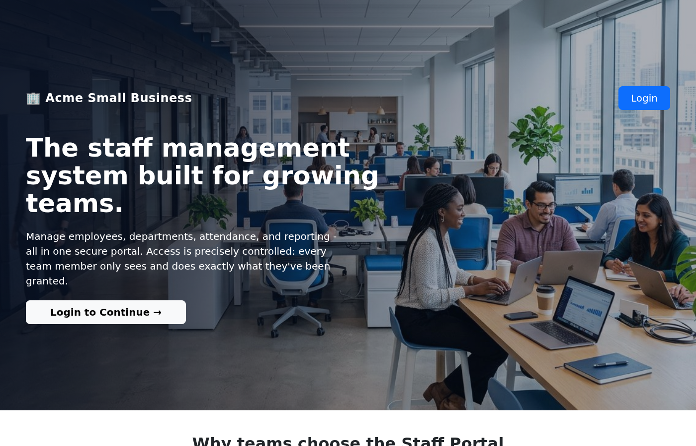 | **Login Page** 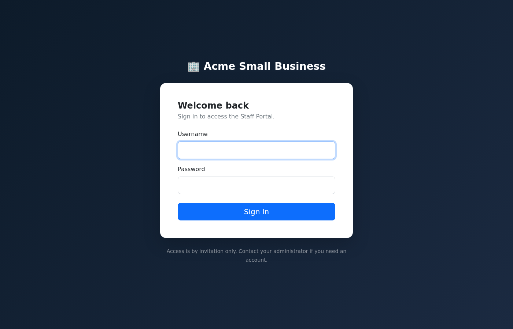 |
| **Super Admin Dashboard** 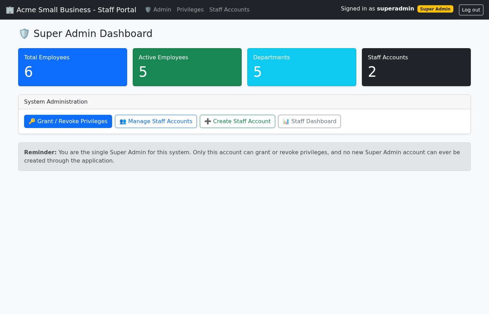 | **Grant/Revoke Privileges** 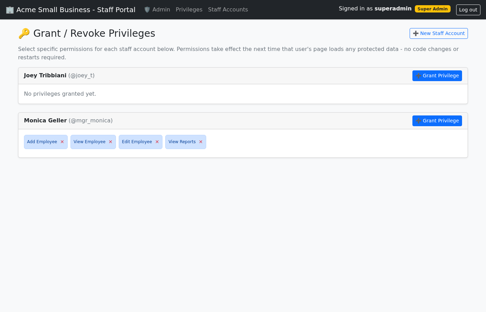 |
| **Grant Privilege Modal** 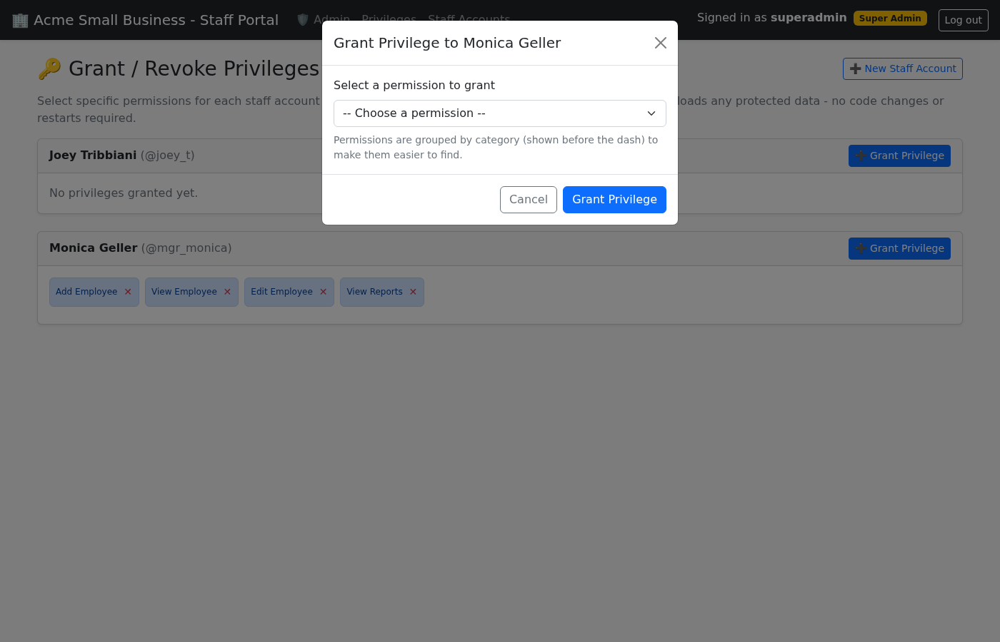 | **Manage Staff Accounts** 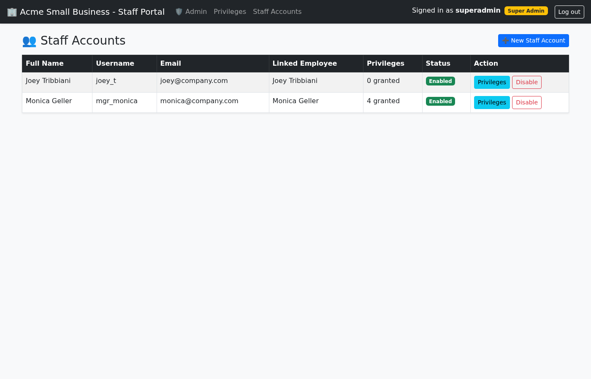 |
| **Create Staff Account** 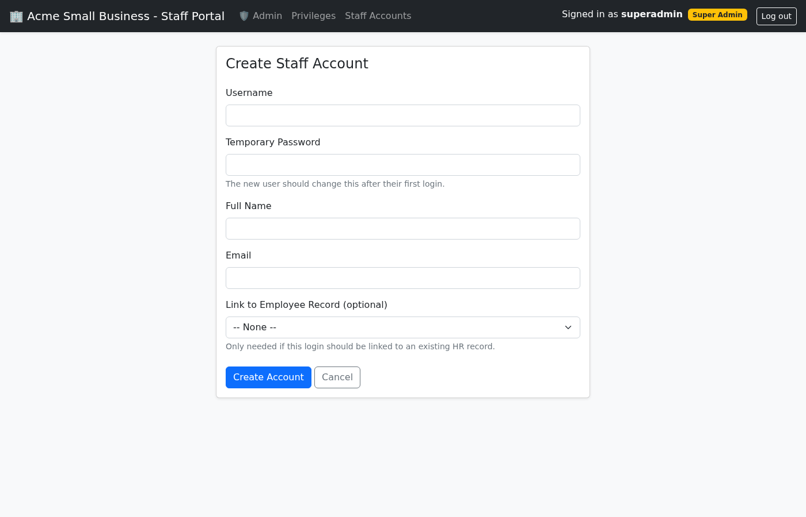 | **Staff Dashboard** 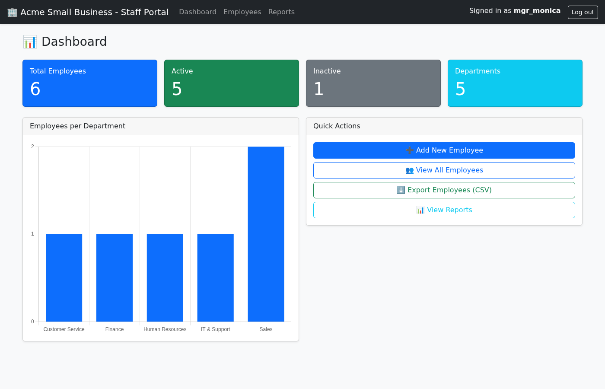 |
| **Employee List (limited actions)** 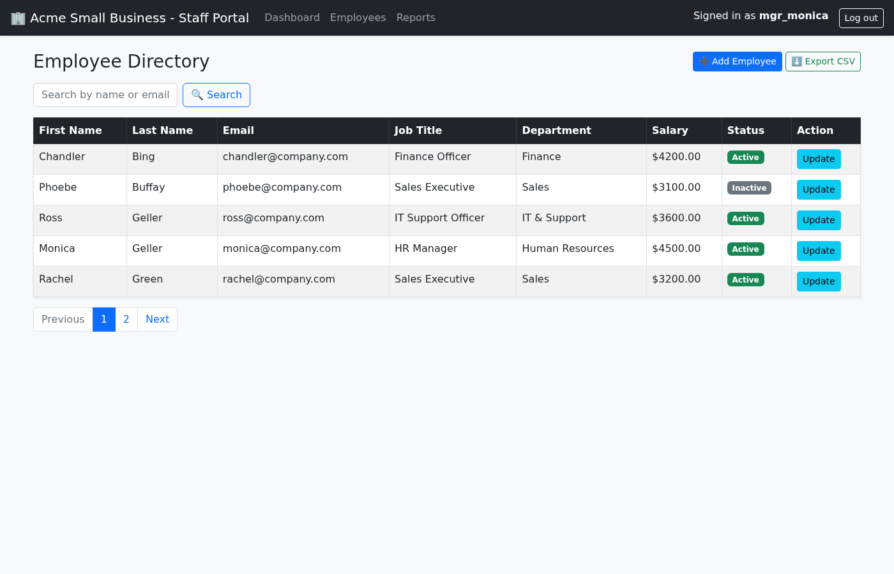 | **Reports (permission-gated)** 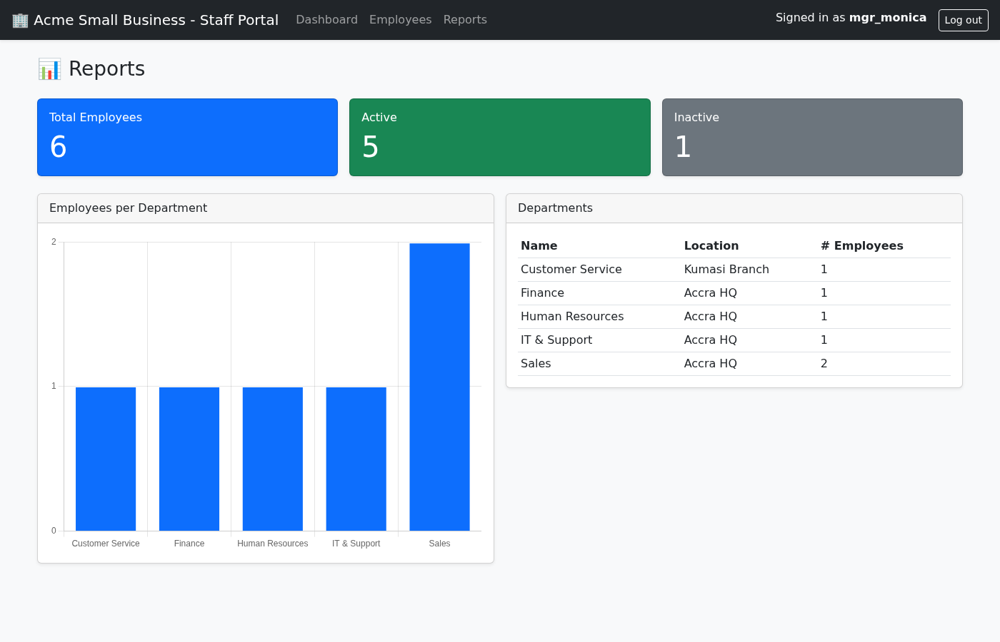 |
| **Plain Employee Self-Service Profile** 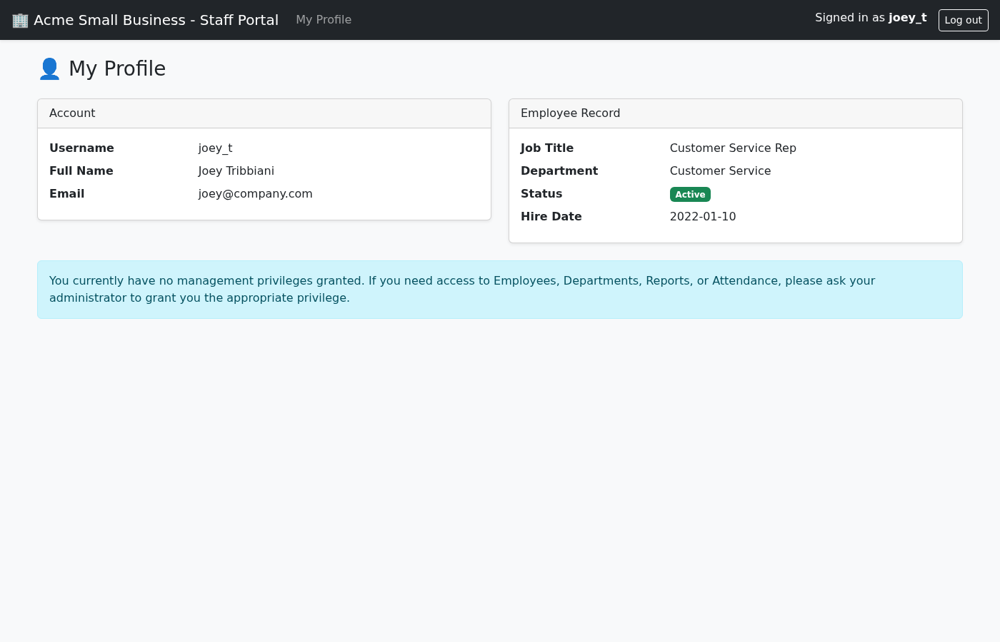 | **Access Denied Page**  |

## 11. Future Improvements and Production Hardening

### Recently added
- Self-service password change flow for logged-in users
- Admin password reset flow for staff accounts
- Security audit log page for admin review of password/account/permission actions
- Docker support for container-based startup

### Planned next steps
- Real REST-style `PUT`/`DELETE` requests instead of `GET` links for delete actions
- Integration tests with Testcontainers
- More advanced rate limiting and failed-login lockout protection
- Full deployment automation with Docker Compose or Kubernetes
- Expanded audit reporting and export features

> Note: The project is best understood as a Waterfall-style implementation with a clear upfront design, not an Agile sprint-based project. The roadmap above is simply a list of planned enhancements, not evidence of an Agile lifecycle.
# vitalops-hr

